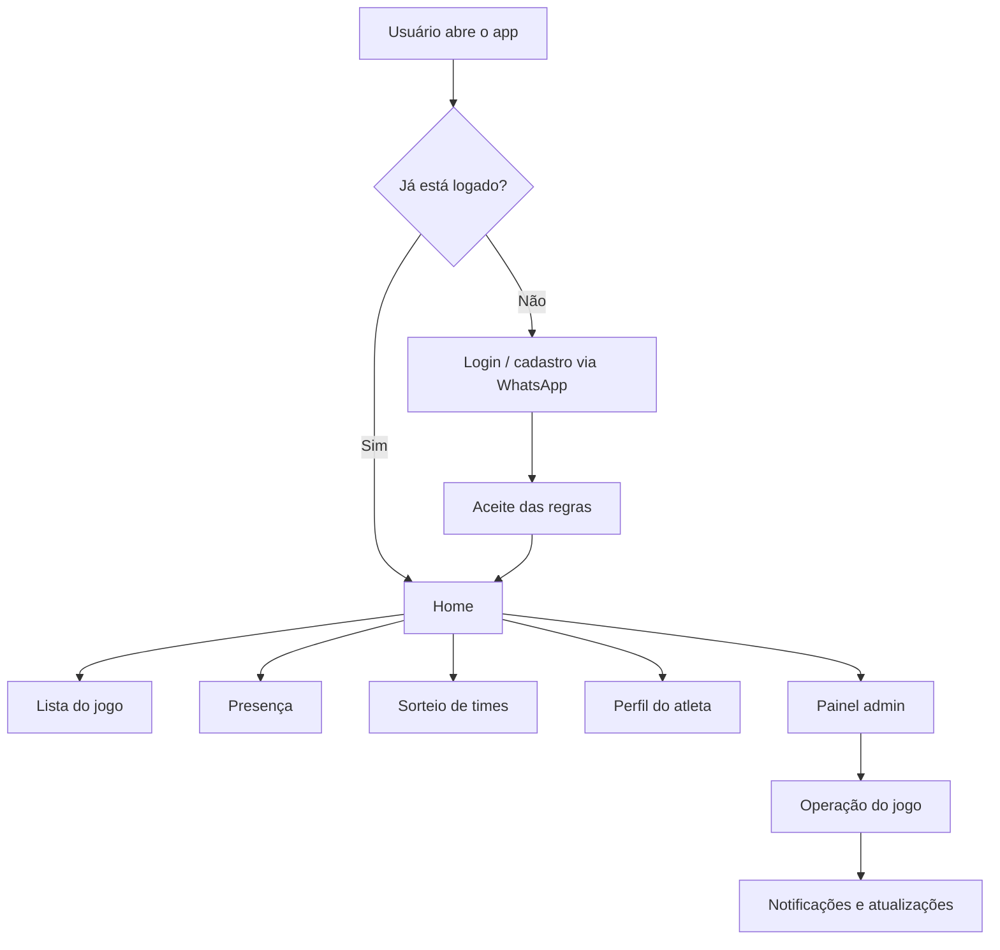
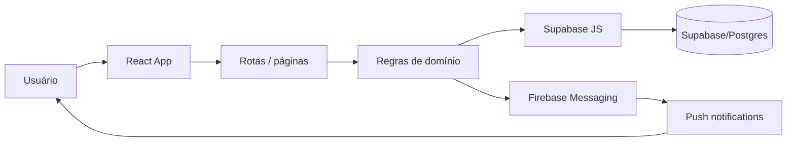
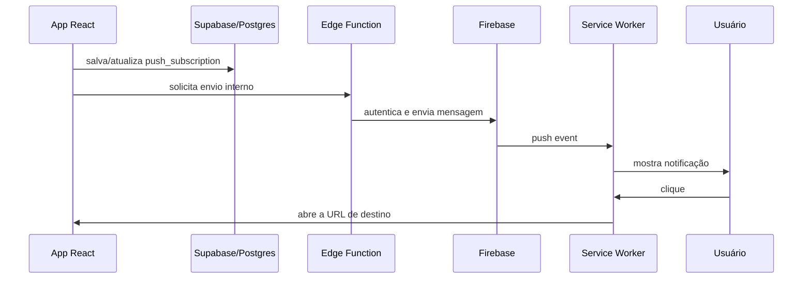

# Conecta Vôlei


Aplicação web **mobile-first** para gestão de um grupo de vôlei de quadra. O projeto organiza listas de jogo, presença, sorteio equilibrado de times, perfil de atletas, penalidades, conquistas e uma experiência de uso pensada para o celular, com funcionamento como PWA.

## O que o app faz

- login e cadastro por WhatsApp
- aceite de regras para liberar o uso do sistema
- listas de jogo com fila principal, espera e convidados
- promoção automática da lista de espera quando abre vaga
- controle de presenças e histórico por jogo
- sorteio equilibrado de times com critérios de nível, posição, capitão e distribuição por perfil
- perfil público do atleta com estatísticas e badges
- painel administrativo para operação do grupo
- notificações push para avisos importantes
- navegação otimizada para telas pequenas

## Fluxo geral



## Regras principais de lista

- jogo de **domingo**: lista abre na **quinta às 19h**
- o sistema respeita regras diferentes para membros e convidados
- quando alguém sai da lista principal, a espera pode ser promovida automaticamente
- há suporte para abertura forçada de lista em jogo específico

## Stack

- **Frontend:** React 19 + Vite 8
- **Roteamento:** React Router DOM 7
- **Backend / dados:** Supabase JS 2
- **Push notifications:** Firebase + Supabase Edge Functions
- **PWA:** `vite-plugin-pwa`
- **Ícones:** Lucide React
- **Testes:** Vitest + Testing Library

## Arquitetura em alto nível



### Camadas relevantes

- `src/app/` — shell da aplicação, provider de autenticação e rotas principais
- `src/pages/` — telas de login, home, regras, atletas, perfil, jogos, times e admin
- `src/domain/` — regras de negócio: listas, sorteio, rankings, badges, permissões e constantes
- `src/lib/` — clientes e integrações com Supabase e Firebase
- `src/components/` — blocos reutilizáveis de interface
- `supabase/` — migrations, config e edge functions

## Organização do repositório

```text
src/
  app/          shell da aplicação, AuthContext e roteamento
  components/   UI reutilizável e blocos de tela
  domain/       regras de negócio, constantes e cálculos
  lib/          integrações com Supabase e Firebase
  pages/        páginas da aplicação
  tests/        setup de testes
public/         assets estáticos, favicon, push handler e ícones PWA
supabase/       migrations, funções edge e configuração local
```

## Funcionalidades de domínio que vale destacar

- `src/domain/gameRules.js` — abre e fecha listas por dia e horário do jogo
- `src/domain/teamDraw.js` — sorteio e pontuação de equilíbrio de times
- `src/domain/badges.js` — sistema visual de conquistas
- `src/domain/matchStatistics.js` — consolidação de estatísticas e premiações
- `src/domain/admins.js` — controle atual de administradores por WhatsApp
- `src/domain/rulesVersion.js` — versão corrente das regras do grupo

## Banco e integrações

O app usa Supabase como backend principal.

### Principais estruturas já presentes

- `players`
- `games`
- `game_registrations`
- `game_presences`
- `game_teams`
- `push_subscriptions`
- bucket `avatars`

### Push notifications

A implementação de push está distribuída entre:

- `public/push-handler.js` — service worker para exibir e abrir notificações
- `supabase/functions/send-push-notification/index.ts` — envio das notificações
- `supabase/migrations/20261015212016_push_notifications.sql` — estrutura de banco, funções e permissões



## Ambiente local

### Pré-requisitos

- Node.js 20+
- npm 10+

### Variáveis de ambiente

Crie um arquivo `.env` na raiz do projeto:

```env
VITE_SUPABASE_URL=https://SEU-PROJETO.supabase.co
VITE_SUPABASE_ANON_KEY=SUA_ANON_KEY

VITE_FIREBASE_API_KEY=SUA_FIREBASE_API_KEY
VITE_FIREBASE_AUTH_DOMAIN=SEU-PROJETO.firebaseapp.com
VITE_FIREBASE_PROJECT_ID=SEU_PROJETO
VITE_FIREBASE_STORAGE_BUCKET=SEU_PROJETO.appspot.com
VITE_FIREBASE_MESSAGING_SENDER_ID=SEU_MESSAGING_SENDER_ID
VITE_FIREBASE_APP_ID=SEU_APP_ID
VITE_FIREBASE_VAPID_KEY=SUA_VAPID_KEY
```

Sem essas variáveis, os fluxos com banco e push não funcionam corretamente.

### Como rodar

```bash
npm install
npm run dev
```

Aplicação local: `http://localhost:5173`

### Scripts

```bash
npm run dev       # ambiente de desenvolvimento
npm run build     # build de produção
npm run preview   # preview da build
npm run lint      # análise estática
npm run test      # suíte de testes
npm run test:watch
```

## PWA

O projeto já vem configurado como PWA:

- manifesto no `vite.config.js`
- atualização automática do service worker
- ícones e assets dedicados
- experiência instalada no celular como aplicativo

## Deploy

O caminho mais natural é publicar em Vercel ou Netlify.

Checklist antes de subir:

- conferir `.env`
- rodar `npm run lint`
- rodar `npm run build`
- validar variáveis do Supabase e do Firebase no ambiente de produção

## Observações de implementação

- a aplicação usa `lazy()` e `Suspense` para carregar páginas sob demanda
- a base visual usa um design system próprio em `src/index.css`
- admins hoje são definidos por lista local, mas o README e o código já apontam para uma futura migração para banco
- o projeto já prepara terreno para badges, premiações e estatísticas por jogo

## Roadmap natural

- mover admins para tabela dedicada no banco
- ampliar cobertura de testes por domínio
- adicionar observabilidade de erros
- enriquecer a documentação das telas e do fluxo do admin

---

Feito para o grupo **Conecta Vôlei**.
